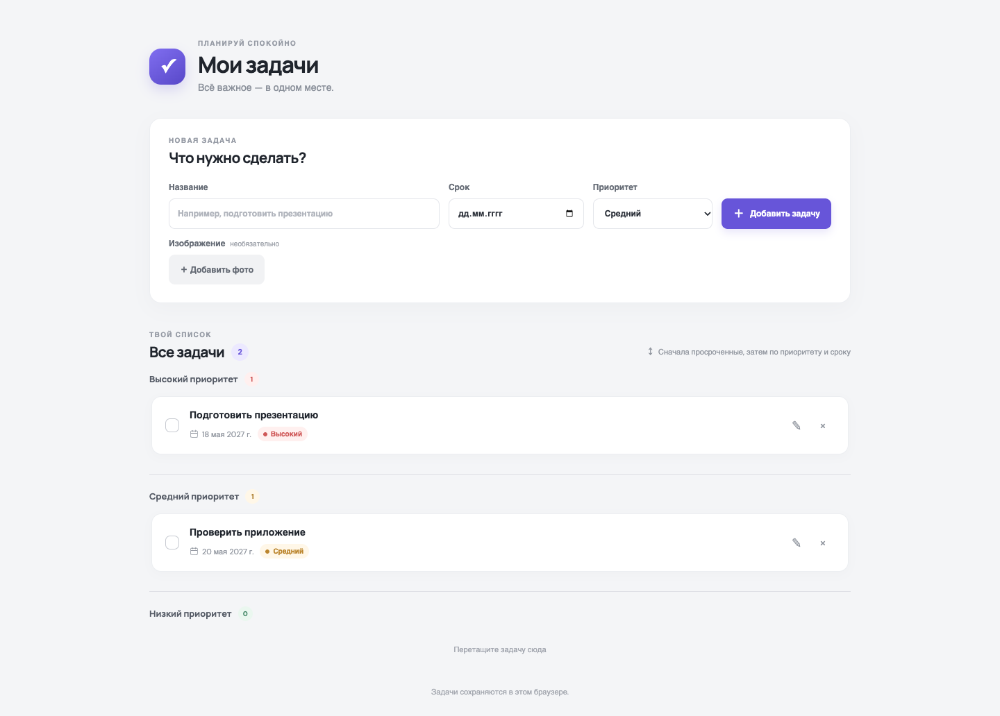
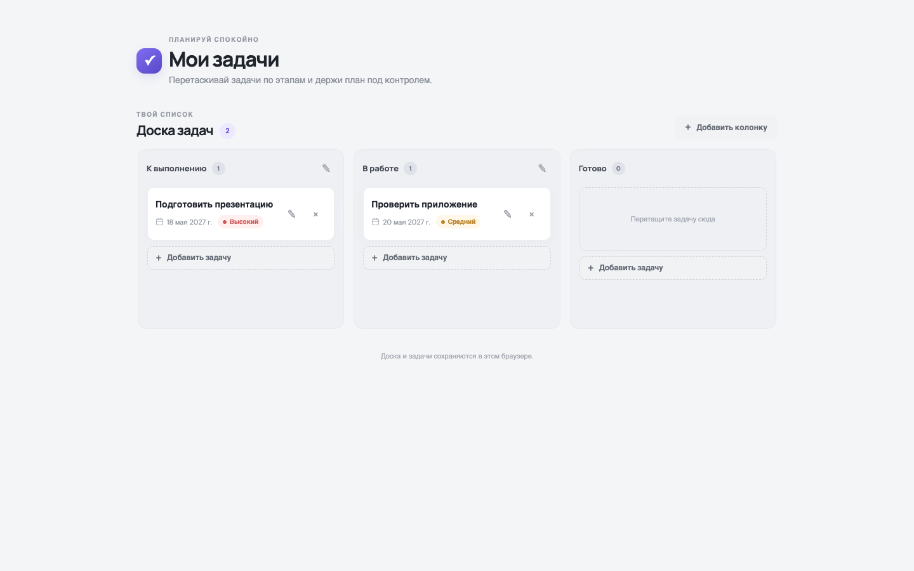
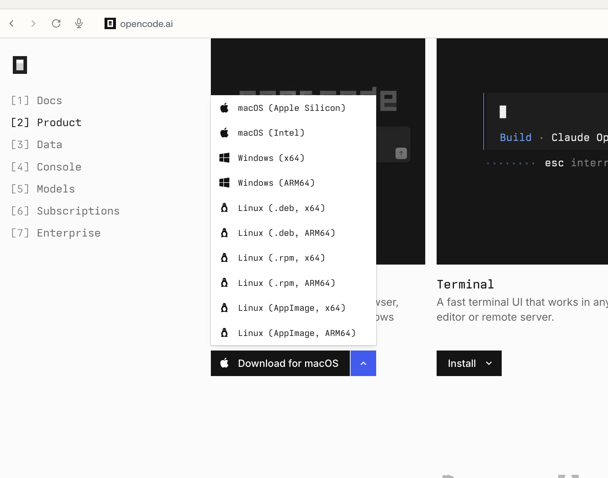

# AI-агенты для разработки: знакомство с OpenCode

Вы уже умеете задавать вопросы ChatGPT или DeepSeek. Можно попросить модель написать программу, получить код и самостоятельно перенести его в проект. А можно работать с AI-агентом, который способен читать файлы проекта, изменять их и запускать проверки.

На занятии мы познакомились с таким подходом на примере [OpenCode](https://opencode.ai/) и небольшого трекера задач.

## Чем агент отличается от обычного чата

Представьте, что вы собираете диван, а знакомый помогает вам по видеосвязи. Он подсказывает, какие детали соединить и какие болты закрутить. Вы выполняете указания, показываете результат и, если что-то не вышло, получаете следующий совет.

Так обычно устроена работа с нейросетью в чате: модель объясняет, а действия выполняете вы. Теперь представьте, что у вашего знакомого есть робот с набором инструментов. Он может поручить роботу взять отвёртку, прикрутить ножку и проверить крепление.

В разработке роль такого помощника выполняет агентная программа, например OpenCode. Она соединяет языковую модель с инструментами (*tools*): позволяет прочитать файл, изменить код, найти нужное место в проекте или запустить проверку. Модель запрашивает действие, получает его результат и выбирает следующий шаг. Это не волшебная палочка: возможности агента зависят от доступных инструментов и разрешений.

## Как мы делали трекер задач

Мы не пытались заранее описать всё приложение. Начали с обычного списка задач: название, срок и приоритет. Обсудили, что должно быть на странице, попросили агента сделать первую версию и открыли её в браузере.

*Первая версия трекера с учебными задачами.*

Затем решили, что удобнее будет Kanban-доска. Вместо отметки «выполнено» появилась колонка «Готово», а карточки стало можно переносить между этапами работы.

*Следующая версия того же проекта.*

Позже добавили несколько досок, учётные записи и совместную работу. Такой способ разработки называют **итеративным**: сделали небольшое изменение, посмотрели результат, обсудили следующий шаг. При этом по мере роста проекта приходится заново продумывать данные и проверки.

## Как ставить задачи агенту

Не обязательно сразу писать подробное техническое задание. Для начала достаточно объяснить цель и попросить обсудить решение:

> Хочу сделать страницу со списком задач. Задачу можно добавить и отметить выполненной. Сначала обсуди со мной интерфейс и предложи простой вариант. Работай в текущей учебной папке.

Когда появится первая версия, откройте приложение и попробуйте им пользоваться. Если обнаружите ошибку, сообщите, **что сделали, чего ожидали и что произошло**. На мастер-классе, например, после добавления задачи на экране оставалась надпись «Пока здесь пусто». Такое описание гораздо полезнее сообщения «ничего не работает».

## Проверяйте то, что получилось

Сообщение агента «готово» не означает, что приложение работает без ошибок. Однажды код уже был исправлен, но в браузере по-прежнему отображалась прежняя версия: Docker-контейнер использовал старую сборку. Изменённые файлы и запущенное приложение — не всегда одно и то же.

Поэтому проверяйте результат сами. Можно спросить агента, что он изменил и какие проверки запустил. И следите за разрешениями: чтение учебного файла, удаление папки и доступ к внешнему серверу — действия с разными последствиями.

## Попробуйте OpenCode

Скачайте приложение с [официального сайта OpenCode](https://opencode.ai/) для своей операционной системы. Выберите подходящую версию и установите её.

*Страница загрузки; её внешний вид может измениться.*

OpenCode — программа для работы с агентом, а не сама языковая модель. Для работы потребуется выбрать модель и при необходимости подключить провайдера. Способы подключения описаны в [документации](https://opencode.ai/docs/). Не публикуйте ключи доступа в чате и не добавляйте их в репозиторий.

Создайте отдельную папку для экспериментов, откройте её в OpenCode и попробуйте сделать небольшое приложение. Начните с обсуждения, затем проверьте первую версию и предложите одно изменение.

## Материалы

- [OpenCode — официальный сайт](https://opencode.ai/)
- [Документация OpenCode](https://opencode.ai/docs/)
- [Разбор мастер-класса: итеративная разработка с AI](https://doomer.ru/iterative-ai-coding-workshop)
