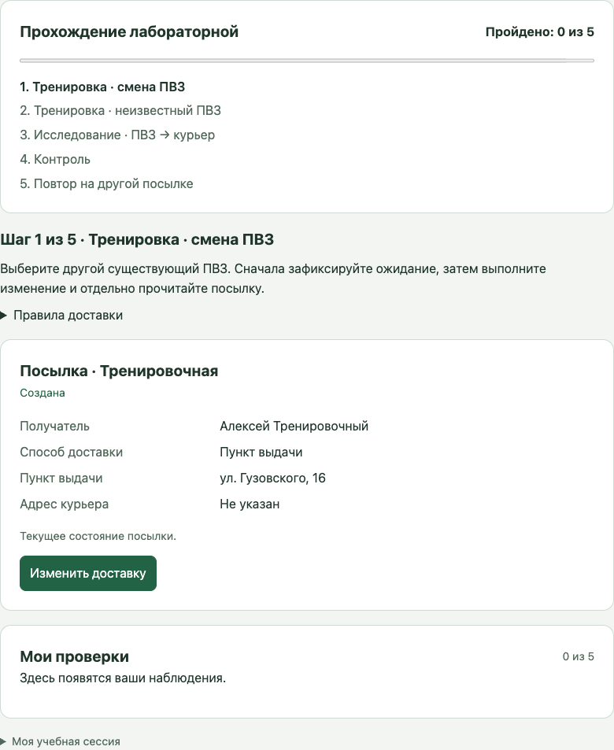
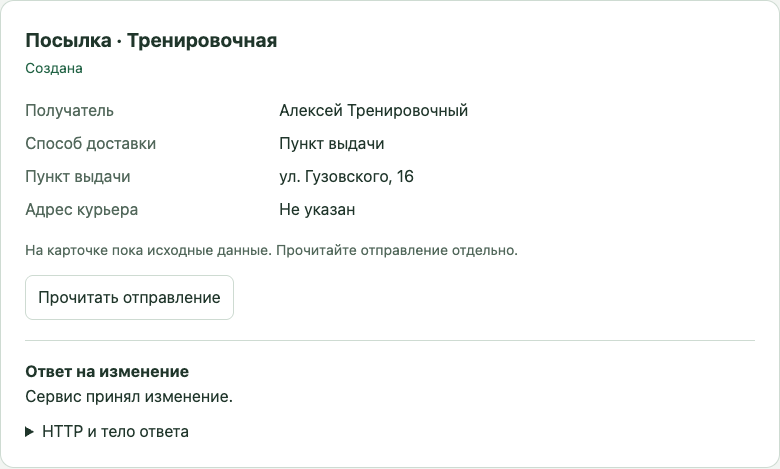
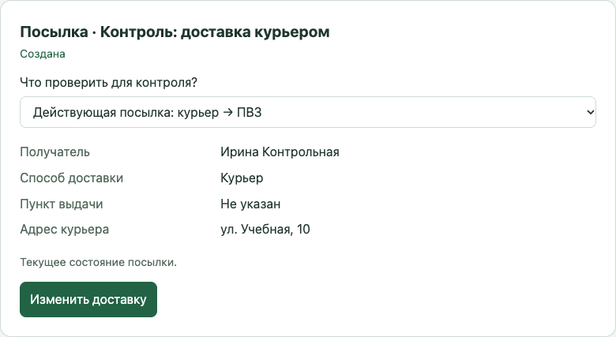
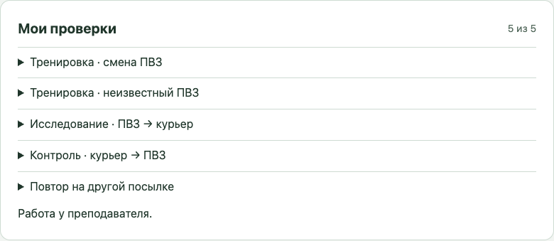

# ЛР №9. Проверяем службу доставки

Работа выполняется на [учебном стенде](https://lab-09.course.denrad.dev/).

## Цель работы

Научиться проверять поведение сервиса по правилам: до действия сформулировать
ожидание, получить фактический результат, найти возможное расхождение и
повторить проверку. Вы будете работать с посылками, пунктами выдачи (ПВЗ)
и адресами курьера.

Работа выполняется индивидуально в браузере. Устанавливать программы, писать
код, вручную вводить JSON или пользоваться Swagger UI не требуется.
Все получатели и посылки на стенде вымышлены.

## Что нужно проверить

Служба доставки должна соблюдать следующие правила:

- У посылки ровно одно назначение: пункт выдачи или адрес курьера.
- При смене способа доставки прежнее назначение очищается.
- Менять доставку можно, пока посылка находится в состоянии **Создана** или
  **Принята**.
- Для доставки в ПВЗ нужен существующий пункт из справочника.
- Если изменение отклонено, сохранённые данные посылки остаются прежними.

В ЛР №7 вы выполняли операции над отправлением. Здесь ваша задача —
проверить, соблюдает ли сервис эти правила после операции.

## Перед началом

1. Откройте [учебный стенд ЛР №9](https://lab-09.course.denrad.dev/).
2. Укажите свои фамилию, имя и группу. Нажмите **Создать учебную сессию**.
3. Раскройте внизу страницы раздел **Моя учебная сессия** и сохраните токен,
   чтобы при необходимости продолжить работу в другом браузере.
   Не публикуйте его и не передавайте другим людям.
4. Вверху появятся список пяти шагов и счётчик **Пройдено: 0 из 5**.
   Нужную посылку стенд подставляет автоматически.

На снимках ниже показана отдельная демонстрационная сессия с вымышленными
данными. Адреса и значения в вашей сессии могут отличаться.

## Как проходит одна проверка

На каждом шаге повторяется один и тот же порядок:

1. Прочитайте задание и исходное состояние посылки.
2. Нажмите **Изменить доставку**. На втором шаге кнопка называется
   **Проверить ПВЗ вне справочника**.
3. Заполните данные изменения и свой прогноз в разделе **Что вы ожидаете?**
   Прогноз сохраняется до запроса; после отправки изменить его нельзя.
4. Нажмите **Зафиксировать прогноз и отправить**.
5. Посмотрите раздел **Ответ на изменение**. Он показывает ответ сервиса
   на выполненное действие.
6. Нажмите **Прочитать отправление**. Это отдельный запрос к серверу:
   карточка посылки обновится сохранёнными данными.
7. Сравните прочитанные данные со своим прогнозом и правилами. В разделе
   **Что разошлось с вашим ожиданием?** отметьте нужные поля или
   **Расхождений нет**.
8. Нажмите **Сохранить проверку**. Появятся отметка **Шаг пройден**,
   зелёное уведомление и кнопка **Следующий шаг**.

**Ответ на изменение и повторное чтение — два разных наблюдения.**
Нажатие кнопки отправки не заменяет проверку того, что сервер сохранил.

Отказ сам по себе ещё не означает дефект. Например, отказ при неверном ПВЗ
может соответствовать правилу. Проверьте причину и состояние посылки после
отдельного чтения.

**Несовпадение с вашим прогнозом само по себе не доказывает дефект: прогноз
тоже может быть ошибочным.** Например, вы могли ожидать, что сервис примет
неизвестный ПВЗ, но корректный отказ соответствует правилу. Отметьте отличие
от своего ожидания, а вывод о дефекте делайте по правилу.

## Ход работы

### Шаг 1. Тренировка: смена ПВЗ

На тренировочной посылке измените пункт выдачи на другой существующий.

1. Прочитайте текущий адрес ПВЗ.
2. Нажмите **Изменить доставку** и выберите другой адрес.
3. Выберите ожидаемый ответ сервиса.
4. Отправьте изменение, затем нажмите **Прочитать отправление**.
5. Проверьте сохранённый адрес ПВЗ и адрес курьера. Сравните результат с
   ожиданием, выберите вывод и сохраните проверку.
6. После отметки **Шаг пройден** нажмите **Следующий шаг**.

Это тренировка на исправном сценарии: корректная смена ПВЗ принимается.
Смысл упражнения — пройти весь цикл проверки и отдельно прочитать результат.

### Шаг 2. Тренировка: ПВЗ вне справочника

На той же посылке проверьте изменение с несуществующим пунктом выдачи.

1. Нажмите **Проверить ПВЗ вне справочника**.
2. В форме уже будет выбрано значение **Учебный ПВЗ вне справочника**.
   Его не нужно искать среди посылок или вводить вручную.
3. Укажите, какой ответ вы ожидаете, и отправьте изменение.
4. Прочитайте отправление отдельной кнопкой. Сравните назначение с тем,
   которое было до запроса.
5. Сохраните наблюдение и нажмите **Следующий шаг**.

В этой тренировке сервис корректно отклоняет неизвестный ПВЗ. Проверьте оба
признака корректного отказа: изменение не принято и прежние данные сохранены.

### Шаг 3. Исследование: ПВЗ → курьер

Проверьте перевод действующей посылки из пункта выдачи к курьеру.

1. Прочитайте исходное состояние и правило об одном назначении.
2. Нажмите **Изменить доставку** и введите вымышленный адрес курьера,
   например **ул. Учебная, 17**.
3. Выберите ожидаемый ответ и укажите, что должно произойти с прежним
   пунктом выдачи.
4. Зафиксируйте прогноз, отправьте изменение и отдельно прочитайте посылку.
5. Сравните **Способ доставки**, **Пункт выдачи** и **Адрес курьера** с
   прогнозом и правилом. При необходимости раскройте JSON.
6. Отметьте обнаруженные расхождения либо **Расхождений нет**, сохраните
   проверку и перейдите дальше.

Не делайте вывод только по сообщению «Сервис принял изменение». Проверьте
само назначение после отдельного чтения.

### Шаг 4. Контроль

Выберите **один** контрольный случай в поле **Что проверить для контроля?**:

- **Действующая посылка: курьер → ПВЗ** — проверка смены назначения в
  обратном направлении.
- **Отменённая посылка: ПВЗ → курьер** — проверка ограничения по статусу.

Для этого шага достаточно одного варианта. Подумайте, какое условие вы
меняете по сравнению с исследованием и какое правило проверяете.

1. Выберите контрольное условие; соответствующая посылка подставится
   автоматически.
2. Прочитайте её статус и назначение.
3. Нажмите **Изменить доставку**, заполните форму и прогноз.
4. Отправьте изменение и отдельно прочитайте состояние.
5. Сохраните наблюдение и нажмите **Следующий шаг**.

Смена только номера посылки или текста адреса при тех же условиях не
заменяет контроль. Здесь важно изменить направление перехода или статус
посылки.

### Шаг 5. Повтор на другой посылке

Повторите исследуемый переход на другой чистой посылке. Стенд выберет её
автоматически.

1. Убедитесь, что исходные условия сопоставимы с исследованием: действующая
   посылка с доставкой в ПВЗ.
2. Сформулируйте прогноз и выполните переход к курьеру.
3. Отдельно прочитайте отправление.
4. Проверьте, повторилось ли наблюдение. Выберите вывод и сохраните проверку.

После этого счётчик покажет **Пройдено: 5 из 5**. Нажмите **Перейти к сдаче
работы**.

## Как читать JSON

Раскрываемые блоки **HTTP и тело ответа** и **HTTP и тело ответа чтения**
показывают фактические ответы сервера.

| Поле | Что означает |
| --- | --- |
| `delivery_method` | Способ доставки: `pickup_point` — ПВЗ, `courier` — курьер. |
| `pickup_point_id` | ID пункта выдачи, например `cheb-003`. |
| `pickup_point_address` | Адрес этого ПВЗ из справочника; помогает сопоставить ID и адрес в карточке. |
| `delivery_address` | Отдельный адрес доставки курьером. |
| `status` | Статус посылки: например `created`, `accepted` или `cancelled`. |
| `null` | Пустое значение: поле не содержит назначения. |

`pickup_point_address` относится к тому же пункту, что и `pickup_point_id`.
Это пояснение к ID, а не второе назначение. Адрес курьера хранится в
`delivery_address`.

В журнале также видны методы и коды ответа: `PATCH` изменяет доставку,
`GET` читает состояние; `200` означает выполненный запрос, `422` — отказ
из-за недопустимых данных, `409` — отказ из-за состояния посылки.
Чтобы оценить соблюдение правила, сверяйте код с данными и условиями запроса.

## Сдача и результат

1. Откройте раздел **Мои проверки**. В нём должны быть пять записей:
   обе тренировки, исследование, один контроль и повтор.
2. Раскройте записи и проверьте блок **До изменения**, свои ожидания,
   наблюдения и связанные ответы. Блок **До изменения** показывает сохранённое
   исходное состояние именно той посылки, на которой выполнялась проверка.
3. Нажмите **Сдать работу**.
4. Убедитесь, что появилось сообщение **Работа у преподавателя**.
   Позовите преподавателя для защиты.

Зелёное уведомление и отметка **Шаг пройден** подтверждают сохранение
проверки. **Счётчик 5 из 5 сам по себе не является оценкой и не доказывает,
что все выводы верны.** Преподаватель смотрит доказательства и сохраняет
результат защиты вручную.

Будьте готовы показать исходные условия, свой прогноз, фактическое чтение,
контрольный случай и повтор. Объясните, почему обнаруженное поведение
нарушает правило либо почему отказ является корректным.

Скриншоты и отдельный текстовый отчёт сдавать не нужно: карточка собирается
из журнала автоматически. После сдачи обновите страницу, чтобы увидеть
сохранённую преподавателем оценку и комментарий.

## Если что-то не получается

- **Неясно, куда идти дальше.** Смотрите заголовок текущего шага. После
  сохранения проверки нажмите **Следующий шаг**; другую посылку искать
  не нужно.
- **Не видно ПВЗ вне справочника.** Он находится в форме второго шага,
  открываемой кнопкой **Проверить ПВЗ вне справочника**.
- **Не удаётся отправить форму.** Прочитайте красное уведомление и заполните
  поля прогноза. Адрес курьера должен содержать не менее пяти символов;
  используйте вымышленный адрес.
- **Ответ получен, но шаг ещё не пройден.** Нажмите **Прочитать отправление**,
  выберите вывод и нажмите **Сохранить проверку**.
- **Прогноз заблокирован.** Он уже записан до действия. Продолжите текущую
  проверку с сохранённым прогнозом.
- **Страница обновилась.** В том же браузере сессия восстанавливается
  автоматически. В другом браузере раскройте **У меня уже есть токен**,
  вставьте сохранённый токен и нажмите **Продолжить работу**.
- **Токен не принимается.** Сессия действует 24 часа. Обратитесь к
  преподавателю; повторная регистрация создаёт отдельную сессию с новым
  прогрессом.
- **Оценки ещё нет.** Статус **Работа у преподавателя** означает, что карточка
  сдана и ожидает проверки. Обновите страницу после защиты.
