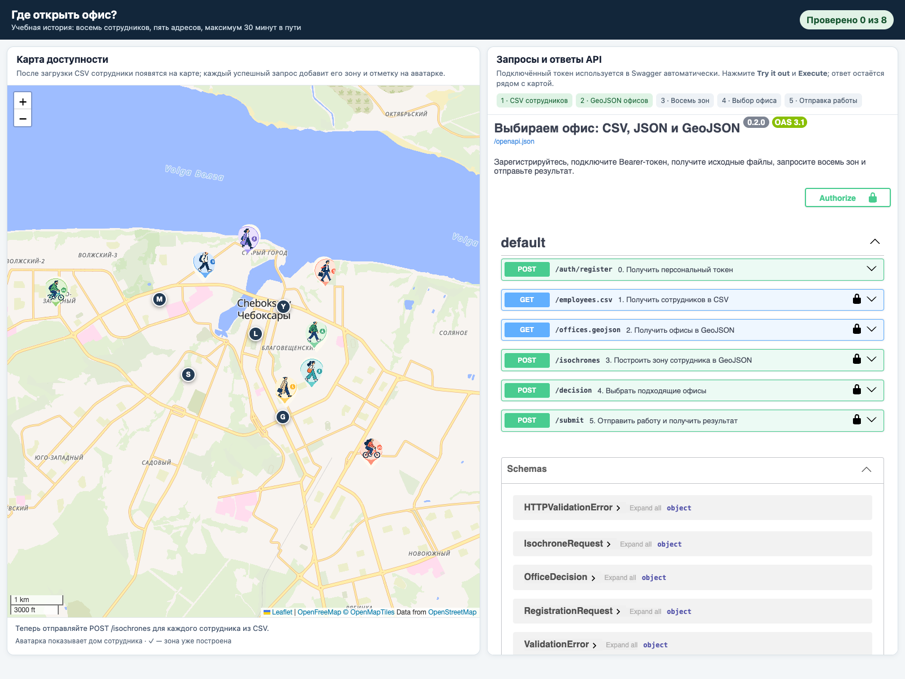
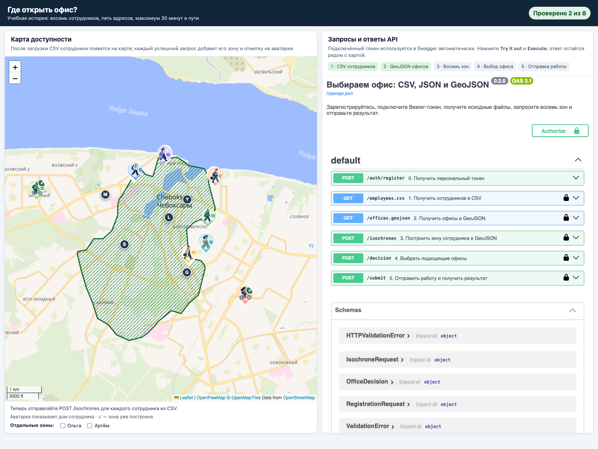
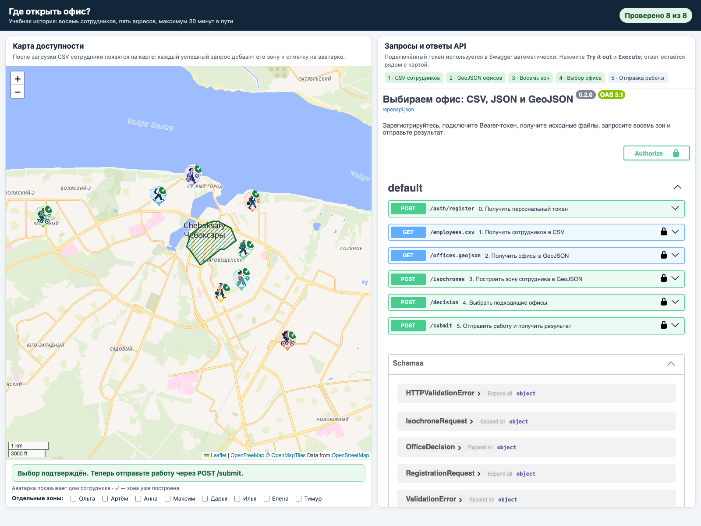

# Практикум к лекции № 10. Выбираем место для офиса по геоданным


Работа выполняется на [учебном стенде](https://lab-10.course.denrad.dev/).

## Цель работы

Научиться читать и использовать данные в форматах CSV, JSON и GeoJSON на
практическом примере. Вы загрузите список сотрудников и кандидатов в офисы,
запросите зоны доступности, увидите их пересечение на карте и выберете
подходящие адреса.

## Задача

Команда выбирает место для офиса в Чебоксарах. Есть восемь условных сотрудников
и пять адресов-кандидатов. Для каждого сотрудника дорога до офиса должна
занимать не более 30 минут с учётом указанного в таблице способа передвижения.
Нужно определить, какие адреса подходят всей команде.

Сотрудники и их имена придуманы для учебного примера. Расчёт времени и контуры
доступности основаны на упрощённой модели; карта показывает результат этой
модели, а не обещание фактического времени поездки.

Работа выполняется индивидуально в браузере. Устанавливать программы,
писать код или сдавать отдельный файл не нужно. Запросы отправляются через
Swagger UI на странице стенда, а результат каждого шага появляется на карте.

## Как устроен GeoJSON

GeoJSON — это формат JSON для географических объектов. В нём отдельно
записываются геометрия объекта и его свойства. Например, точка офиса может
выглядеть так:

```json
{
  "type": "Feature",
  "properties": {
    "id": "A",
    "address": "Примерная улица, 1"
  },
  "geometry": {
    "type": "Point",
    "coordinates": [47.20, 56.15]
  }
}
```

`properties` хранит описательные поля, а `geometry` — тип и координаты
геометрии. У `Point` это одна пара координат; у `Polygon`, который сервер
возвращает для зоны доступности, координаты задают контур. Несколько объектов
часто объединяются в `FeatureCollection` — именно так представлены офисы.

В массиве GeoJSON координаты идут в порядке **долгота, широта**. В JSON-теле
запроса на построение зоны они передаются отдельными полями `latitude` и
`longitude`, поэтому при заполнении запроса важно не перепутать значения.

## Перед началом

1. Откройте страницу локального стенда, которую покажет преподаватель.
2. Зарегистрируйтесь, указав свои фамилию, имя и группу. Нажмите **Получить
   токен**. Токен подключается автоматически; сохраните его на время занятия,
   чтобы при необходимости восстановить сессию.
3. Не передавайте токен другим людям и не указывайте в форме чужие или другие
   персональные данные. Сессия и запросы записываются под заявленными вами
   фамилией, именем и группой.

Слева находится карта и счётчик обработанных сотрудников. Справа — список
операций API и их ответов. Для отправки каждого запроса нажмите **Try it out**,
заполните данные и нажмите **Execute**.

## Ход работы

### 1. Загрузите сотрудников из CSV

Выполните `GET /employees.csv`. Проверьте, что сервер вернул код `200` и
таблицу из восьми записей. В ней есть поля:

- `id` — код сотрудника;
- `name` — имя в учебном примере;
- `address` — адрес точки на карте;
- `latitude`, `longitude` — широта и долгота;
- `mode` — способ передвижения: `walk` или `bike`.

После загрузки на карте появятся аватарки сотрудников. Значок внутри аватарки
показывает способ передвижения; зелёная галочка появится после построения зоны
для этого сотрудника. Первый этап будет отмечен в списке запросов.

### 2. Загрузите офисы из GeoJSON

Выполните `GET /offices.geojson`. Сервер вернёт `FeatureCollection` с пятью
объектами `Feature`. Посмотрите их `properties`: там находятся код и адрес
офиса. В `geometry` у каждого офиса указана точка `Point`.

В массиве координат GeoJSON порядок такой: **долгота, широта**. На карте
появятся пять офисов с кодами. Сохраните коды: они понадобятся при отправке
решения.



### 3. Постройте зоны доступности сотрудников

Для каждого сотрудника из CSV выполните `POST /isochrones`. В запросе укажите
его широту, долготу и способ передвижения. Предел времени во всех запросах —
30 минут.

Например, тело запроса для Анны:

```json
{
  "latitude": 56.1458246,
  "longitude": 47.2664731,
  "mode": "walk",
  "minutes": 30
}
```

Здесь координаты передаются отдельными именованными полями JSON. Не перепутайте
их с порядком координат в массиве GeoJSON: там сначала идёт долгота, затем
широта. Для велосипедистов используйте значение `bike`, для остальных —
`walk`.

После успешного запроса сервер вернёт GeoJSON-объект `Feature` с геометрией
зоны и добавит сотрудника в счётчик. Карта обновляется после каждого запроса.
На снимке показан промежуточный результат для двух сотрудников из восьми:
зоны пересеклись, но в пересечение пока попадает несколько офисов. Это только
пример того, как меняется карта; по нему ещё нельзя выбирать офис.



Продолжайте, пока не отправите запросы по всем восьми строкам CSV. Когда
счётчик покажет `8 из 8`, заштрихованная область будет итоговым пересечением
для всей команды.

### 4. Выберите подходящие офисы

Сравните точки офисов с итоговой заштрихованной областью. Выберите все офисы,
которые подходят **каждому** сотруднику, и отправьте `POST /decision`. В тело запроса
впишите коды из GeoJSON:

```json
{
  "office_ids": ["код_офиса_1", "код_офиса_2"]
}
```

Замените примеры кодов на найденные вами. Если выбор принят, статус под картой
подсветится зелёным и появится сообщение, что осталось отправить работу. Если
ответ содержит `accepted: false`, внимательно сравните офисы с общей областью,
исправьте список и отправьте запрос ещё раз. Повторно строить зоны не нужно.



### 5. Отправьте работу

После подтверждения выбора выполните `POST /submit`. Проверьте ответ: для
зачтённой работы поле `result` должно содержать `passed`. На странице появится
постоянный зелёный статус о выполнении работы и сохранении результата в системе.


## Критерии выполнения

Работа считается выполненной, когда:

- загружены CSV сотрудников и GeoJSON офисов;
- сервер построил зоны для всех восьми сотрудников;
- отправлен принятый список подходящих офисов;
- после `POST /submit` получен результат `passed`.

Стенд записывает действия и результат автоматически. Скриншоты и отдельный
отчёт от студента не требуются. Будьте готовы коротко объяснить преподавателю,
чем CSV отличается от JSON и GeoJSON, и почему порядок координат в теле запроса
отличается от порядка координат в GeoJSON.

## Если запрос не сработал

- Прочитайте всплывающее сообщение: оно показывает причину отказа.
- Если сервер сообщает, что сотрудник не найден, сверьте обе координаты и
  значение `mode` с одной строкой CSV.
- Если общая область ещё не появилась, проверьте, что счётчик показывает
  восемь обработанных сотрудников.
- Если решение не принято, проверьте коды офисов и отправьте `POST /decision`
  повторно. Уже построенные зоны сохранятся.
- Если токен не принимается, подключите сохранённый токен через пункт
  **У меня уже есть токен**. Повторная регистрация создаёт новую сессию.

## Условия расчёта

В этой работе используется зафиксированная учебная модель: пешком — 4,5 км/ч,
на велосипеде — 12 км/ч; маршруты построены по данным сети OpenStreetMap.
Контуры на карте приближённо показывают достижимую область и её пересечение.
Результат нужен для изучения форматов и работы с данными и не является
официальной оценкой транспортной доступности.
